# Chessdle · Ajedrez + Wordle

**Descubre aperturas de ajedrez a través de un juego de palabras y explora sus movimientos en un tablero interactivo.**

Chessdle conecta un Wordle de cinco letras con un catálogo de aperturas, perfiles de usuario y colecciones personales. Cada palabra está asociada a una apertura: al acertarla, puedes añadirla a tus descubrimientos, consultar su descripción y visualizar su secuencia de movimientos.

La aplicación combina un **frontend en Flutter**, un **backend HTTP en Java y Spring Boot** y una **implementación propia del tablero en Dart**, con generación de movimientos, simulación de seguridad del rey y lógica de jaque y mate.

Proyecto académico desarrollado para **Programación Avanzada de Apps**, en la **Universidad San Francisco de Quito (USFQ)**. Entrega: **mayo de 2024**.

## Una partida, una apertura por descubrir

1. Inicia una partida y encuentra la palabra de cinco letras en un máximo de seis intentos.
2. Utiliza las pistas de color del tablero y del teclado para ajustar tus siguientes intentos.
3. Al ganar, pulsa **Check it Out** para guardar la apertura en tus descubrimientos si tienes una sesión iniciada.
4. Abre su ficha para consultar la descripción, interactuar con el tablero y visualizar una variante.

También puedes acceder directamente al catálogo desde **Explore**, guardar favoritos y volver a ellos desde tu perfil. Los descubrimientos constituyen una colección personal; la consulta del catálogo está disponible desde la sección de exploración.

## Capturas

Las siguientes pantallas recorren el flujo de la aplicación, desde el inicio de una partida hasta la exploración de una apertura y sus variantes. Corresponden a la entrega académica de mayo de 2024.

### Inicio, navegación y partida

| Pantalla de inicio | Menú de navegación | Tablero de Wordle |
| --- | --- | --- |
| 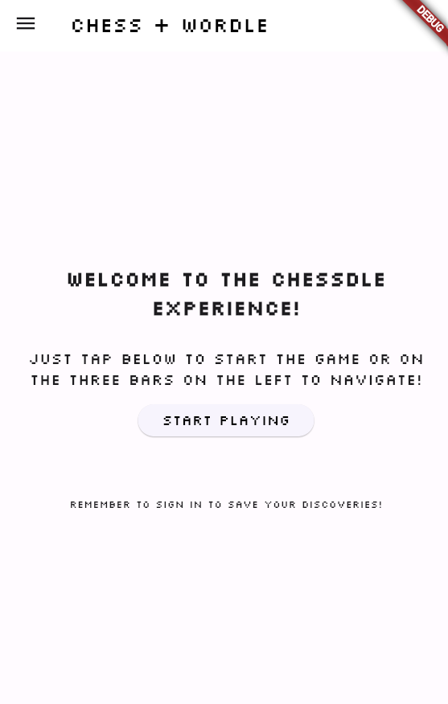 | 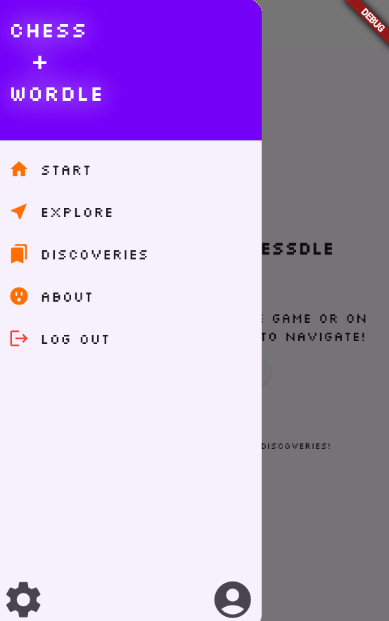 | 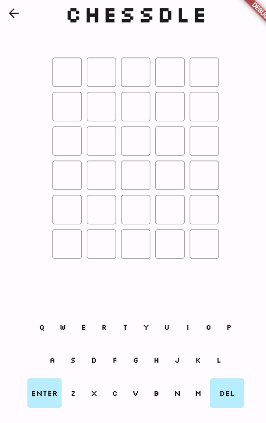 |

### Pistas, victoria y descubrimientos

| Evaluación de un intento | Apertura descubierta | Colección personal |
| --- | --- | --- |
| 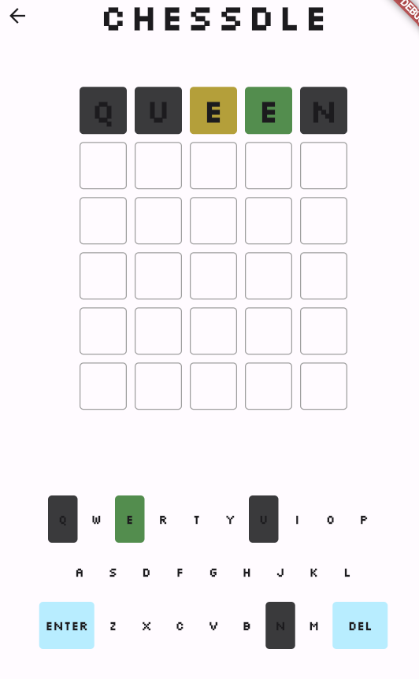 | 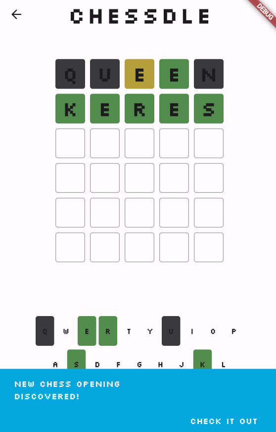 |  |

### Exploración de aperturas

| Ficha de apertura | Secuencia reproducida | Vista de una variante |
| --- | --- | --- |
| 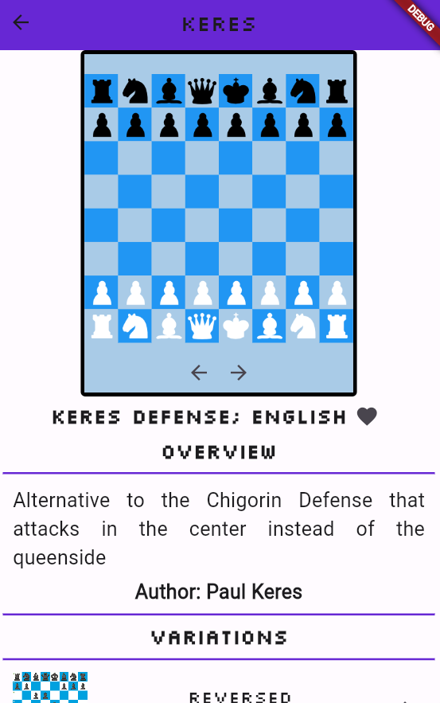 | 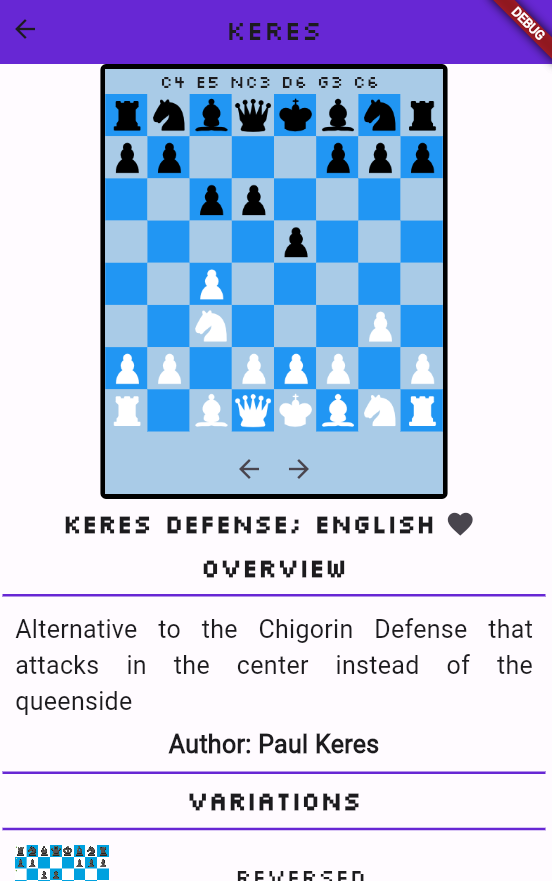 | 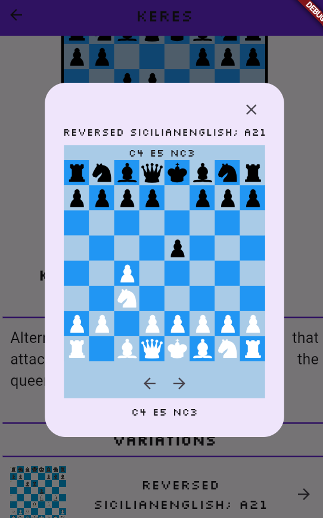 |

## Funcionalidades

### Juego de palabras

- Palabras de cinco letras vinculadas a aperturas de ajedrez.
- Seis intentos por partida, con teclado en pantalla y acciones de borrado y envío.
- Pistas de posición y presencia de letras, reflejadas en las casillas y el teclado.
- Revelado secuencial de resultados mediante animaciones de giro.
- Acceso a la colección de descubrimientos desde la acción de victoria.

### Explorador de aperturas

- Catálogo con fichas de título, descripción, autor registrado y secuencia de movimientos.
- Tablero interactivo con selección de piezas y resaltado de destinos válidos.
- Movimientos básicos para peones, torres, caballos, alfiles, damas y reyes.
- Capturas y filtrado de movimientos mediante simulación de seguridad del rey.
- Lógica de detección de jaque y mate.
- Visualización de la secuencia de una apertura y consulta de una variante en un tablero adicional.

### Perfiles y colecciones

- Registro, inicio y cierre de sesión.
- Perfil con biografía editable.
- Aperturas favoritas que se pueden añadir, consultar y retirar.
- Colección de aperturas descubiertas con persistencia local en el servidor.

## Arquitectura

```text
Flutter
├── Pantallas, navegación y perfiles
├── Wordle: estado, evaluación y animaciones
└── Tablero: piezas, movimientos y simulación
                    |
              RestClient / HTTP
                    |
Spring Boot · RestService
├── AppController: catálogo y usuario activo
├── WordleController: palabras y selección de partida
└── User / Opening / OpeningInfo
                    |
       Archivos TXT y CSV + índices en memoria
```

El backend carga usuarios, aperturas y palabras al iniciar. `RestService` expone las operaciones HTTP; `AppController` relaciona palabras clave con secuencias de movimientos y objetos de apertura mediante mapas en memoria. `Opening` y `OpeningInfo` reúnen los metadatos del catálogo, mientras que `User` gestiona biografía, favoritos y descubrimientos.

En Flutter, `RestClient` centraliza las peticiones al backend. Las pantallas utilizan `FutureBuilder` para presentar datos asíncronos y `StatefulWidget` para las interacciones. El servidor selecciona la palabra de la partida y el cliente evalúa los intentos del Wordle.

El tablero mantiene una matriz de piezas de 8 × 8. La generación de movimientos utiliza recorridos por dirección y desplazamientos según el tipo de pieza; después, simula cada movimiento candidato para descartar los que dejan al rey en jaque. El widget `GameBoard` recibe una secuencia textual y se reutiliza tanto en la ficha principal como en el diálogo de variantes.

## Diagramas de clases

Los diagramas de la entrega académica presentan las clases del backend, sus relaciones y los componentes del tablero en Flutter.

### Organización del backend

`AppController` conecta el catálogo de aperturas, los perfiles y el controlador del juego de palabras. Cada `Opening` agrupa su información y sus variantes mediante `OpeningInfo` y un mapa de secuencias.

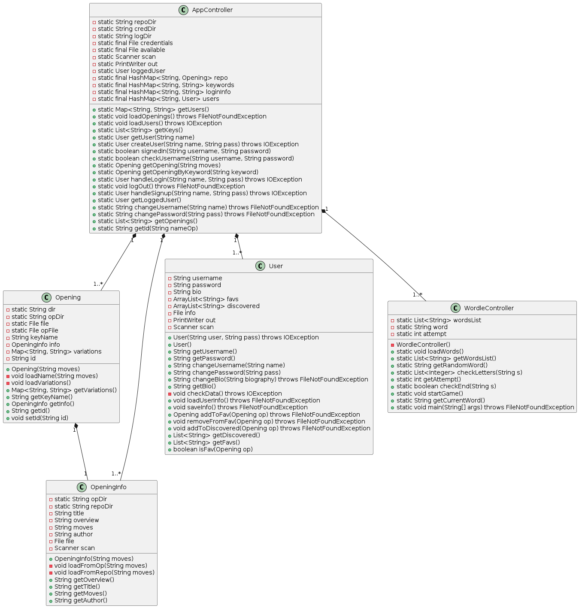

### Controlador de la aplicación

`AppController` mantiene los índices en memoria y reúne las operaciones de carga, consulta de aperturas y gestión del usuario activo.

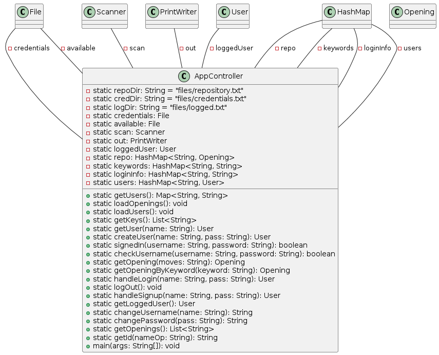

### Usuarios y colecciones

`User` reúne los datos del perfil, la biografía, los favoritos y los descubrimientos, junto con las operaciones de lectura y escritura de su archivo local.

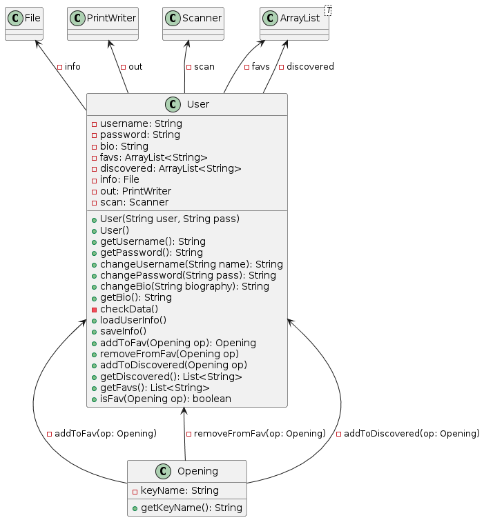

### Aperturas y metadatos

`Opening` representa una apertura mediante su palabra clave, código ECO, información y variantes. `OpeningInfo` reúne el título, la descripción, el autor y la secuencia de movimientos a partir de los archivos del catálogo.

| Apertura | Información de la apertura |
| --- | --- |
| 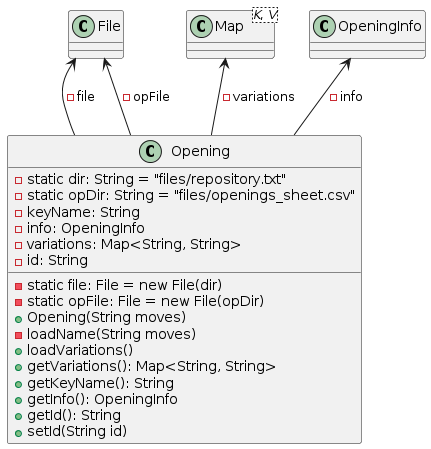 | 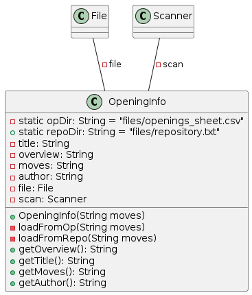 |

### Controlador de Wordle

`WordleController` obtiene las palabras del catálogo, selecciona la palabra objetivo y expone operaciones de consulta y evaluación al backend.

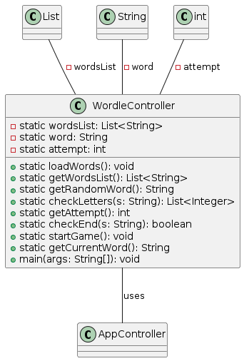

### Tablero interactivo

`GameBoard` recibe la secuencia de una apertura y crea su estado. `_GameBoardState` mantiene las piezas, la selección, los movimientos y el historial; `Square` representa cada casilla y `ChessPiece` encapsula el tipo y el color de una pieza. El diagrama también incluye `DeadPiece`, un componente de representación de capturas que no se utiliza en la interfaz final.

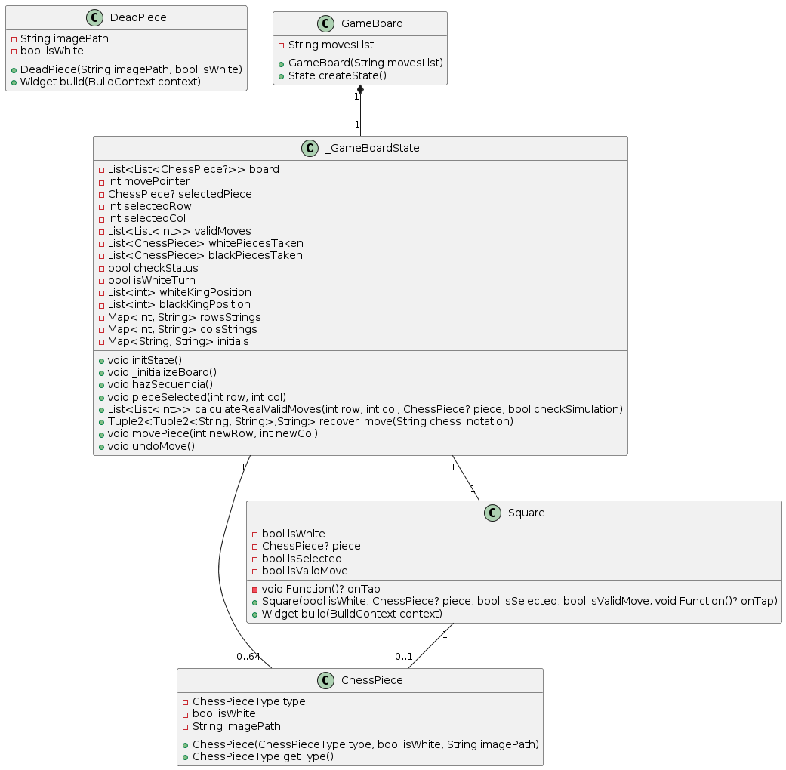

## Tecnologías

| Área | Tecnologías |
| --- | --- |
| Backend | Java 17, Spring Boot 3.2.5 y Spring Web |
| Construcción del backend | Maven y Maven Wrapper 3.9.6 |
| Frontend | Flutter, Dart y Material |
| Comunicación | HTTP y JSON mediante el paquete Dart `http` |
| Estado e interfaz asíncrona | `StatefulWidget`, `setState`, `FutureBuilder` y `Navigator` |
| Animaciones y modelos | `flip_card`, `equatable` y `google_fonts` |
| Persistencia | Archivos TXT y CSV, `HashMap` y listas en memoria |
| Herramientas de calidad | Flutter Lints y prueba de contexto de Spring Boot |

La persistencia funciona con archivos locales y no requiere un servicio de base de datos. `flutter_bloc` forma parte de las dependencias declaradas; la gestión del estado de la aplicación utiliza los mecanismos de Flutter descritos en la tabla.

## Estructura del proyecto

```text
.
├── Proyecto/Proyecto/
│   ├── Backend/backend/
│   │   ├── pom.xml
│   │   ├── mvnw / mvnw.cmd
│   │   └── src/
│   │       ├── main/java/backend/
│   │       │   ├── api/                 # Arranque y endpoints HTTP
│   │       │   └── app/
│   │       │       ├── src/             # Controladores y modelos
│   │       │       ├── files/           # Catálogo y persistencia
│   │       │       └── users/           # Perfiles de usuario
│   │       └── test/                    # Prueba de contexto
│   └── Frontend/flutter_frontend/
│       ├── pubspec.yaml
│       ├── lib/gui/                     # Pantallas y cliente HTTP
│       ├── lib/wordle/                  # Juego de palabras
│       ├── lib/board/                   # Tablero, reglas y recursos
│       └── android/, ios/, web/, ...    # Proyectos de plataforma
├── Caps/                               # Capturas de la aplicación
├── Diagrams/                           # Diagramas de clases
├── User_ClassDiagram.png
└── Informe_ChessLe.pdf                  # Memoria del proyecto
```

## Catálogo de demostración

La demo incluye cuatro aperturas activas, definidas en `repository.txt`:

| Palabra | Apertura | Secuencia |
| --- | --- | --- |
| `KINGS` | King's Pawn Opening | `e4` |
| `QUEEN` | Queen's Pawn Opening | `d4` |
| `KERES` | Keres Defense; English | `c4 e5 Nc3 d6 g3 c6` |
| `ANGLO` | Anglo-Dutch | `c4 e5 Nc3 f5` |

El archivo `openings_sheet.csv` aporta **2.727 registros de referencia** para títulos y variantes, además de su cabecera. El catálogo jugable se define por separado: estas filas no se incorporan automáticamente como palabras del Wordle. `openings.txt` conserva diez entradas adicionales fuera del flujo principal de carga.

## Ejecución local

### Requisitos

- JDK 17.
- Flutter con Dart compatible con `>=3.2.5 <4.0.0`. El archivo de dependencias registra Flutter `>=3.16.6`.
- Acceso a los repositorios de dependencias durante la preparación del entorno.

### 1. Compilar y arrancar el backend

Desde la raíz del repositorio, en una terminal Bash:

```bash
cd Proyecto/Proyecto/Backend/backend
./mvnw -DskipTests package
cd ../..
java -jar Backend/backend/target/backend-0.0.1-SNAPSHOT.jar
```

Ejecuta el proceso Java desde **`Proyecto/Proyecto/`**: las rutas de datos parten de `Backend/backend/src/main/java/backend/app/` y dependen de ese directorio de trabajo. Para el funcionamiento de la aplicación, conserva esa estructura de archivos junto al backend.

El comando de empaquetado omite las pruebas. La prueba de contexto incluida requiere ajustar la localización de la configuración de Spring Boot antes de incorporarla al flujo de validación. En Windows, utiliza `mvnw.cmd` para compilar y mantén el mismo directorio de trabajo al iniciar Java.

### 2. Arrancar el frontend

En otra terminal, desde la raíz del repositorio:

```bash
cd Proyecto/Proyecto/Frontend/flutter_frontend
flutter pub get
flutter run -t lib/gui/main.dart
```

El punto de entrada es **`lib/gui/main.dart`**. Inicia primero el backend: el cliente comprueba la conexión antes de abrir la interfaz.

### Conexión con el servidor

La dirección del backend se configura en `RestClient.baseUrl`, dentro de `lib/gui/main.dart`:

```dart
static const String baseUrl = 'http://localhost:8080';
```

Para ejecutar el cliente en otro equipo, un emulador o un dispositivo físico, configura una dirección que permita acceder al servidor desde ese entorno. `localhost` identifica al equipo o dispositivo donde se ejecuta el cliente.

El proyecto incluye estructuras para Android, iOS, web, Linux, macOS y Windows. La compatibilidad y la configuración de red y distribución deben validarse para cada plataforma; los APK incluidos corresponden a compilaciones de depuración de la entrega original.

## Alcance de la versión

Chessdle es un **prototipo académico para ejecución local**, centrado en integrar el juego de palabras, la exploración de aperturas y las colecciones de usuario. La versión actual tiene el siguiente alcance:

- **Reproducción del tablero:** el avance ejecuta toda la secuencia de la apertura. El avance paso a paso y la restauración completa de capturas y estado al retroceder quedan pendientes.
- **Reglas y notación:** incluye movimientos básicos y comprobaciones de jaque y mate. El enroque, la promoción, la captura al paso y el soporte completo de notación algebraica quedan fuera de esta versión.
- **Variantes:** cada apertura carga la primera coincidencia de su código ECO en el catálogo de referencia.
- **Wordle:** la evaluación de letras repetidas es simplificada y los intentos no se validan contra un diccionario. La selección aleatoria requiere corregir el índice para incluir el último elemento de la lista.
- **Integración:** varias mutaciones HTTP y sus acciones dependientes requieren sincronización. Los descubrimientos se guardan al pulsar la acción de victoria.
- **Sesiones:** el servidor mantiene un usuario activo y una palabra compartidos; las sesiones independientes y las partidas multijugador quedan fuera del alcance actual.
- **Seguridad:** las credenciales se almacenan en texto plano y se transmiten mediante parámetros GET; la API incluye un endpoint que devuelve el mapa de credenciales. El uso como servicio público requiere rediseñar la autenticación y la autorización.
- **Validación y entrega:** la pantalla de ajustes es informativa. La suite funcional, las pruebas Flutter, la integración continua y la configuración de despliegue quedan pendientes.

## Documentación

Las capturas y los diagramas se incluyen en este documento junto con la descripción funcional, la arquitectura y las instrucciones de ejecución. 

## Equipo

Chessdle integra tres proyectos individuales en una aplicación común:

| Integrante | Proyecto de origen |
| --- | --- |
| Atik J. Santellán | Explorador de aperturas de ajedrez con tablero interactivo |
| Guillermo Tapia | Wordle de palabras en inglés |
| Mateo Vivanco | Repositorio de manuales de juegos de mesa con usuarios y favoritos |
